# Saydown for Windows

Hold a key, talk, release. Cleaned-up text is pasted at your cursor, in any app.

A private dictation app for Windows. Your speech is transcribed by Whisper and tidied by a small language model (Google's Gemma 4 E4B), both running on your PC: on your NVIDIA graphics card when you have one, otherwise on the processor. No recording ever leaves your computer, and there is no account or subscription.

## What it does

- **Push to talk.** Hold the right Alt key, speak, release.
- **Hands-free.** Double-tap right Alt to keep listening, and tap once more to stop.
- **Or click to talk.** A small, mostly see-through pill sits above the taskbar. Click it to start and click again to stop. Clicking it never takes the focus from the app you are typing in.
- **Cleans up speech.** Filler sounds (um, uh, hmm) and stutters are dropped. Spoken lists ("First… second… third…", "Here are my tasks: …") become numbered or bulleted lines.
- **Drops what you took back.** "Let's meet on Tuesday, no wait, Wednesday" becomes "Let's meet on Wednesday." The language model runs only when you correct yourself ("sorry", "no wait", "I mean", "scratch that"); everything else is tidied by rule, with no model call.
- **Rewrite in a style.** Each dictation in the window has a Rewrite button: Grammar, Polite, Sugarcoated, Shorter, Bullet points, Summary, Tasks, Email, Daily update, Meeting notes, Thought dump, or a style you define in the Styles tab. A box takes a one-off instruction, such as "make it more confident".
- **Ask.** The Ask tab answers questions from your saved dictations ("what did I say about pricing?") and cites the ones it used. It searches by meaning, with a small embedding model.
- **Voice commands.** Off by default; turn them on in Settings. Within two minutes of a dictation, "make that shorter", "fix the grammar" or "undo that" changes the text just typed, by pressing Ctrl+Z and pasting the new text. Opening with a style name ("Daily update. Yesterday I…") types the rest in that style.
- **Personal dictionary.** Names and jargon you list are spelled your way. `x ai -> xAI` always replaces one with the other.
- **A window to manage it.** It shows your history and stats, Ask, the dictionary, styles and settings. Right-click the pill to open it.
- **Notes.** "Record a note" in the window records into history without typing anything. Then use Rewrite → Meeting notes, Tasks or Summary on it.
- **Never loses a dictation.** If the language model is not ready or fails, the transcript is tidied by rule and typed anyway.

## Install and run

You need Windows 10 or 11, about 12 GB of free disk space and, for speed, an NVIDIA graphics card. Download this repository (Code → Download ZIP, then unzip it somewhere permanent, such as your Documents folder), open the folder, and run:

```
powershell -ExecutionPolicy Bypass -File install.ps1
```

This installs [uv](https://docs.astral.sh/uv/) if you don't have it, and adds Saydown to the Start menu with its icon. Add `-Desktop` for a desktop shortcut, `-Startup` to start Saydown when you sign in, or `-Remove` to take the shortcuts away. uv installs Python and Saydown's packages on its own, including NVIDIA's CUDA libraries.

Then open **Saydown** from the Start menu. To run it from a terminal instead, with a log of every dictation, double-click **`start.bat`** or run:

```
uv run saydown.py
```

The first run downloads the Python packages (about 2 GB, mostly NVIDIA's libraries), the speech model (about 1.6 GB) and the AI models (about 5.5 GB). The window shows progress. You can dictate as soon as the speech model is ready; the AI features switch on when theirs arrives. If a download fails, dictation still works and Saydown tries again the next time it opens.

On a graphics card with 8 GB, both models fit at once: Whisper takes about 1.6 GB and Gemma about 3.8 GB. With less room, part of Gemma runs on the processor, which is slower. Gemma is dropped from memory after 30 idle minutes and takes about 6 seconds to load again.

The Start menu shortcut runs it without a console window. Quit from Settings → Quit Saydown.

Your history, dictionary, styles and settings live in `%APPDATA%\Saydown` (`history.jsonl`, `dictionary.txt`, `styles.json`, `settings.json`), as does the log, `saydown.log`.

### Permissions

Windows asks for no keyboard permission. The microphone has to be allowed for desktop apps: Settings → Privacy & security → Microphone → "Let desktop apps access your microphone". The setup card in the window has a button that opens that page if it is off.

## Usage

Click into any text field, then:

- hold **right Alt**, say a sentence, and release,
- double-tap right Alt to record hands-free, then tap it once more to stop, or
- click the pill, speak for as long as you like, and click it again.

Recordings shorter than 0.3 seconds are ignored as accidental taps. Right Alt still works as Alt in key combinations. Saydown just stops a lone press from opening an app's menu bar.

To change the shortcut, open Settings → Shortcut → Change. Then press a single modifier key (right Ctrl, say), a function key, or a combination such as Ctrl+Alt+D. A combination is swallowed so the app in front never sees it.

Pasting goes through the clipboard. Text you had copied is put back right afterwards.

## Configuration

| Setting | Where | Default |
|---|---|---|
| Shortcut | Settings | Right Alt |
| Microphone | Settings | Windows default input |
| Dictation language | Settings | Auto-detect |
| Idle pill visibility | Settings | 30% |
| Pill position | Settings | Bottom |
| Save history | Settings | On |
| Voice commands | Settings | Off |
| Whisper model | `WHISPER` at the top of `saydown.py` | large-v3-turbo |
| Text model | `TEXT_MODEL` at the top of `ai.py` | Gemma 4 E4B, Google's 4-bit QAT build |

On a laptop with an RTX 2070 Max-Q (8 GB), `bench.py` scores the text model at 44/44. It checks cleanup, rewriting, editing, voice commands and Ask. Typical times are 0.23 s for a cleanup, 0.05 s for a voice-command check and 0.5 s for a rewrite. Score another model with `bench.py` before changing `TEXT_MODEL`.

## How it works

- A low-level keyboard hook (`SetWindowsHookEx`) watches for the shortcut in every app.
- `sounddevice` records from the microphone through WASAPI, only while you dictate.
- `faster-whisper` transcribes the audio, with its voice filter dropping silence.
- `textrules.py` cleans up the transcript by rule. When you corrected yourself, it asks the text model what you meant.
- `ai.py` runs the text model with llama.cpp (`llama-cpp-python`, built for NVIDIA cards) and holds the prompts for Rewrite, Ask and voice commands.
- The result goes to the clipboard and is pasted with Ctrl+V.

The pill is a borderless Tk window marked `WS_EX_NOACTIVATE`, so clicking it never moves the focus. The window is `ui.html`, shown by Edge as an app window. It talks to Saydown over a localhost-only server that rejects requests from any other website.

## Testing

```
uv run --no-project --with numpy python -m unittest test_rules test_app test_ai -v
```

`test_rules` checks the cleanup rules: fillers, stutters, lists and the dictionary. `test_app` checks the shortcut handling, settings, history, pill placement and the clipboard. `test_ai` checks what reaches the language model and the fallbacks when it is missing, with the model mocked. All three run in a second.

```
uv run bench.py
```

This scores the real text model on cleanup, rewriting, editing, voice commands and Ask.

```
powershell -File make_test_audio.ps1
uv run --no-project python test_e2e.py
```

This is an end-to-end run on your PC. It starts Saydown, presses right Alt in a real window, and plays synthetic speech (from the Windows voice) in place of the microphone. Then it checks what gets pasted, across hold-to-talk, hands-free, clicking the pill, a spoken self-correction, a "Scratch that" voice command and clipboard restore. It moves the mouse once, so leave the keyboard and mouse alone for the minute it takes.

## Known limits

- Voice commands press Ctrl+Z, so they assume you have not typed since the dictation, and they do nothing useful in apps without undo.
- Ask does not find dictations by date ("what did I say yesterday").
- The first dictation after 30 idle minutes that needs the text model waits about 6 seconds while it loads.
- Only text is put back on the clipboard after a paste. An image or files you had copied are replaced by the dictation.
- Windows does not let an ordinary app type into a program running as administrator. Dictation into one does nothing; the text is still in history with a Copy button.
- A microphone plugged in after launch appears in Settings, and is used as the new default, only after a restart (or once the old one stops working).
- Text appears when you release the key, not as you speak.
- Without an NVIDIA graphics card, Whisper runs on the processor and takes a few seconds per dictation.

## On a Mac?

Saydown started on the Mac: see [Saydown for Mac](https://github.com/shreylad/saydown).

## Licence

MIT. See LICENSE.
